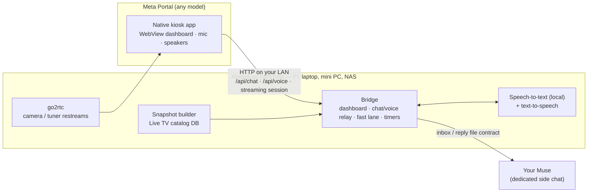

# Portal → Muse

**Give a Meta Portal a second life as a home AI terminal.**

A Portal is a good screen, a good far-field microphone, and good speakers, trapped in software that doesn't do much anymore. This project turns one into an always-on kitchen/living-room terminal for [Muse](https://muse.ai): a glanceable dashboard, streaming voice conversation with your own Muse agent, timers, smart-home scenes, recipes, cameras, Plex, live TV, and YouTube casting — all on your home network, with no system modification to the Portal at all.

It works because Meta left a supported door open: current Portal software includes an official ADB setting (Settings › Debug › ADB Enabled) meant as the device's end-of-life offramp. Everything here is built on that toggle, a sideloaded app, and a small bridge program on a computer you already leave on. No bootloader unlock, no reflash (there isn't one), no exploits.

> Validated end-to-end on a 2018 Gen 1 Portal (10", Android 9). Other models should work — the guides flag every step that needs re-checking on a different generation.

## Architecture

Three pieces:

1. **A native Android app on the Portal** — full-screen dashboard (a web page served by the bridge), the Portal's own microphone and speakers for voice, and native screens for settings, cameras, Plex, and live TV. A native app matters: a browser page on Portal can't reliably use the microphone.
2. **A bridge on an always-on home computer** — serves the dashboard, transcribes speech locally, relays conversations to your Muse through a simple file contract, speaks replies, answers simple questions itself in ~a second (time, weather, timers), and pushes app updates to the Portal over Wi-Fi ADB.
3. **A dedicated Muse conversation** for the Portal, so kitchen questions don't mix with your main chats.

## What you need

- A Meta Portal (original, Mini, +, Go, or later — see the model notes in the guides)
- A Muse setup — this project is a terminal *for your own Muse agent*, which also does most of the building for you
- An always-on computer on your home network (Raspberry Pi, old laptop, Mac mini, Windows PC, NAS — anything that stays awake)
- A Mac or PC + a **data** USB cable for the first app install
- Optional: Home Assistant (scenes), cameras go2rtc can restream, a Plex server, an IPTV subscription, an HDHomeRun tuner

## Features (as validated on the reference build)

- Dashboard: big clock, weather, calendar, household notices — readable across a room
- **Streaming voice**: replies start playing in seconds, live captions for both sides, a status pill that tells the truth (Portal has no echo cancellation, so it's half-duplex — interrupt by wake word or tap)
- Text chat, named timers with tap-to-stop, local fast lane for simple questions
- Smart-home scenes via Home Assistant; recipes where you cook
- Security cameras via go2rtc; native Plex client; YouTube casting via a built-in DIAL receiver
- Live TV: the host merges IPTV catalogs + guide data into one searchable local snapshot every few hours, so browsing/search/favourites are instant and survive provider hiccups. A second IPTV provider and an over-the-air tuner have since been merged into the same snapshot in the reference build (provider-labelled categories, namespaced IDs per source), so the multi-source pattern is production-validated, not just a design — tuner channels ship without guide data for now, and the motion-smoothness fix for their transcodes still awaits its on-device eye check (see the guides)
- Optional on-device wake word, trained on your own voice, with honestly measured detection/false-wake trade-offs
- App updates pushed from the host — the Portal never has to install anything itself (its own installer UI doesn't work for sideloaded apps; the guides explain)

## Quick start

1. Read **[docs/HUMAN_GUIDE.md](docs/HUMAN_GUIDE.md)** — what gets built, what you need, and the full step-by-step ADB + app-install walkthroughs.
2. Hand **[docs/AGENT_GUIDE.md](docs/AGENT_GUIDE.md)** to your Muse — it's the technical playbook, written for the agent doing the build, including verification checklists and the pitfalls that otherwise cost a day.
3. Start with `bridge/bridge_example.py` to see the core relay pattern in a few hundred lines.

## Repository layout

| Path | What it is |
|---|---|
| `docs/HUMAN_GUIDE.md` | The human guide: concept, requirements, ADB and install walkthroughs, honest limitations |
| `docs/AGENT_GUIDE.md` | The agent playbook: architecture, bridge, app rebuild spec, streaming voice, integrations, acceptance checklist |
| `bridge/bridge_example.py` | A minimal, dependency-free reference bridge skeleton — a teaching example, **not** the production bridge |
| `LICENSE` | MIT |

**About the app source:** it is intentionally *not* in this repo. The reference app grew per-household pieces that must never be copied between homes — a wake-word model trained on one person's voice, device identities, one LAN's camera/tuner configuration. `docs/AGENT_GUIDE.md` Appendix A specifies the app (screens, manifest, bridge contract, build rules) in enough detail for your agent to rebuild it cleanly for your household.

## Honest limitations

- YouTube is the casting ceiling — DRM services (Netflix etc.) need certified receivers, which this hardware can't be.
- Portal's ADB connection may switch off on reboot (model-dependent); one wired reconnection revives it.
- Voice will sometimes mishear; anything important also gets an on-screen button.
- It's a home-network appliance by design. Nothing here needs inbound internet access.
- This is a reflash-free project: stock Android/Linux on Portal hardware isn't possible, and isn't needed.

## License / affiliation

MIT — see [LICENSE](LICENSE).

This is an independent, unofficial project. It is **not affiliated with, endorsed by, or sponsored by Meta or Muse**; "Portal", "Meta", and "Muse" are used only to describe what the software works with. Use at your own risk, on your own hardware.
